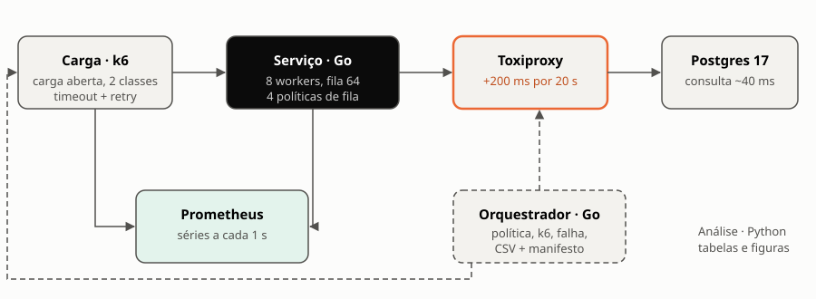
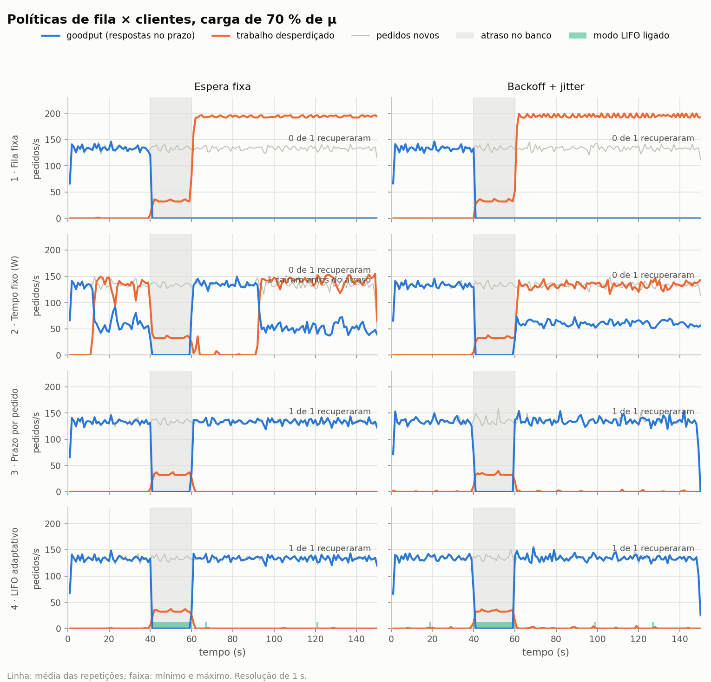
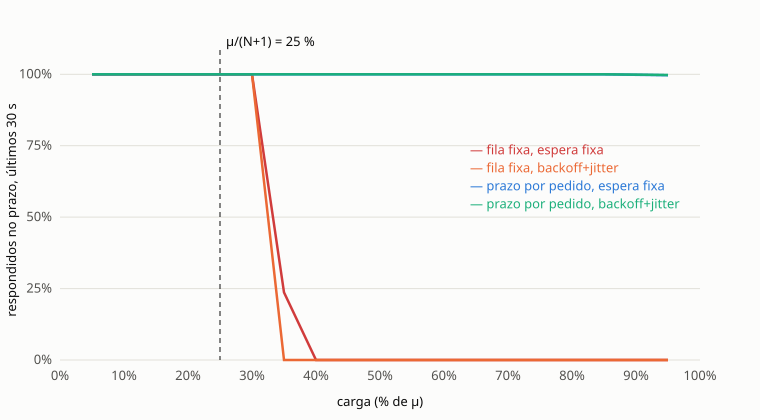

# Políticas de fila contra o laço de retry

**Medindo e evitando falhas metaestáveis num serviço distribuído**

Lab Exame CSC-27 / CE-288 · ITA · 2026
João Guerreiro · Lucas de Sousa · Marcelo Hippolyto · Pablo Carvalho
Orientação: Prof.ª Juliana de Melo Bezerra

> **Em uma frase.** Quando os clientes fazem retry, um atraso de 20 s no banco pode derrubar o
> serviço de vez, mesmo depois que o banco volta ao normal. Construímos uma bancada para
> reproduzir isso e comparamos 4 políticas de fila no servidor. Fazer o servidor **descartar
> pedidos que já não terminam dentro do prazo do próprio cliente** recuperou o serviço em
> todos os casos testados. Já o **backoff com jitter no cliente** não mudou nenhum desfecho.

| Entrega | Onde |
|---|---|
| Relatório (PDF, itens 1–8 do anexo) | [`relatorio/relatorio.pdf`](relatorio/relatorio.pdf) |
| Apresentação | [`apresentacao/apresentacao.pdf`](apresentacao/apresentacao.pdf) · [`.html`](apresentacao/apresentacao.html) (baixe e abra no navegador) |
| Código | [`experimento/`](experimento/) |
| Metodologia detalhada e resultados completos | [`experimento/metodologia.md`](experimento/metodologia.md) · [`experimento/resultados.md`](experimento/resultados.md) |
| Reprodutibilidade em duas máquinas | [`experimento/reprodutibilidade.md`](experimento/reprodutibilidade.md) |
| Análise matemática e simulação | [`experimento/modelo-matematico/`](experimento/modelo-matematico/) |

---

## 1. Motivação

Num sistema assíncrono, o cliente não distingue um servidor lento de um servidor morto. Por
isso ele usa **timeout**: espera um tempo e desiste. Depois faz **retry**, porque a maioria das
falhas é passageira.

O problema é que cada retry é **um pedido novo na mesma fila**, e ele chega justamente quando o
servidor já está lento:

```
dependência lenta ──▶ pedidos esperam além do timeout ──▶ cliente desiste e faz retry
        ▲                                                            │
        └──── servidor ainda processa os abandonados ◀── chegam mais tentativas que a capacidade
```

Se o laço fecha, o sistema **continua fora do ar depois que a causa foi embora**. Ele fica
sustentado pela carga que ele mesmo gera. Isso é uma **falha metaestável** (Bronson et al.,
HotOS '21). Huang et al. (OSDI '22) encontraram 22 casos desse tipo em 11 organizações,
incluindo 4 dos 15 maiores incidentes da AWS da década.

**Por que é um problema de Sistemas Distribuídos:** o problema não está em nenhum componente
isolado. Ele surge da interação entre cliente (timeout, retry), servidor (fila, workers) e
dependência (banco). Para reproduzi-lo, é preciso:

- carga aberta;
- falha injetada no instante certo;
- medição com resolução de 1 s;
- cuidado para que a própria máquina de teste não vire o gatilho.

## 2. Trabalhos relacionados e gap

| Trabalho | Contribuição | O que deixa aberto |
|---|---|---|
| Bronson et al., HotOS '21 | Nomeia o fenômeno e define os estados estável, vulnerável e metaestável | Não mede mitigações |
| Huang et al., OSDI '22 | 22 casos reais; reprodutores abertos | Não compara políticas de fila sob o mesmo gatilho |
| Schroeder et al., NSDI '06 | Carga fechada esconde sobrecarga | Base de método |
| Maurer, *Fail at Scale*, ACM Queue '15 (Facebook) | LIFO adaptativo e CoDel em filas de servidor | Relato de engenharia, sem comparação controlada |
| Nichols e Jacobson, *CoDel*, ACM Queue '12 | Controlar a fila pelo tempo de espera | Pensado para redes |
| Brooker, AWS Builders' Library | Backoff com jitter | Espalha os retries, mas não reduz quantos são |
| Google SRE Book, caps. 21–22 | Propagação de prazo, descarte de carga | Recomendação qualitativa |

**Gap:** as mitigações existem, mas cada uma é descrita isoladamente. Falta uma comparação
controlada, com o mesmo gatilho e as mesmas chegadas, de **qual política tira o sistema do
estado preso, em que carga e a que custo**.

## 3. Objetivo

> Qual **política de fila no servidor** faz o serviço voltar ao normal depois de um atraso
> passageiro no banco, em cargas em que uma fila comum fica presa? Quanto cada uma custa quando
> nada está errado? A resposta depende de como o cliente faz retry?

Este trabalho é a segunda volta de uma investigação:

- **Experimento 1:** mostrou que o laço fecha e que nenhuma política de retry no cliente resolve.
- **Experimento 2 (este):** desloca o foco para o servidor. A mudança está registrada em
  [`docs/decisoes/0002`](docs/decisoes/0002-pivo-politicas-de-fila.md).

## 4. Proposta

### Requisitos

**Funcionais**

- Gerar carga aberta com timeout e retry no cliente, em duas classes de cliente.
- Oferecer 4 políticas de fila, trocáveis com o serviço no ar.
- Injetar atraso no banco numa janela programada, sem tocar no código do serviço.
- Medir por segundo e por classe: respondidos no prazo, trabalho desperdiçado, amplificação,
  descartes e tempo de recuperação.
- Rodar a campanha inteira com um comando, gravando CSV e manifesto de cada execução.

**Não funcionais**

- Capacidade reprodutível (±5 %) e validada pela lei de Little.
- Só Docker no host.
- Comparação justa:
  - mesmas chegadas em todas as configurações;
  - ordem das execuções embaralhada;
  - execuções afetadas por instabilidade do ambiente descartadas automaticamente.

### Arquitetura



| Componente | Tecnologia | Papel |
|---|---|---|
| Serviço | Go | 8 workers, fila de 64 posições, 4 políticas de fila; cada pedido faz uma consulta ao Postgres (~42 ms) |
| Carga | k6 | Chegadas abertas. Dois tipos de cliente, metade cada: **impaciente** (timeout 100 ms) e **paciente** (200 ms). Até 3 retries |
| Injeção de falha | Toxiproxy | Entre serviço e banco: +200 ms por resposta durante 20 s. A capacidade cai de 190 para 33 req/s |
| Banco | Postgres 17 | Banco real em container |
| Observação | Prometheus | Séries a cada 1 s |
| Orquestrador | Go | Calibra, troca a política, roda a carga, liga e desliga a falha, grava os dados |
| Análise | Python | Tabelas, figuras, estatística e simulação |

### As 4 políticas de fila

Todas usam a mesma fila (64 posições) e os mesmos 8 workers. O que muda é **quem é atendido e
quem é descartado**. Pedido descartado recebe 503 na hora.

| # | Política | Regra |
|---|---|---|
| 1 | **Fila fixa** (referência) | FIFO. Rejeita quem chega com a fila cheia. Atende tudo o que entrou, mesmo que o cliente já tenha desistido |
| 2 | **Limite de tempo fixo** | Na saída da fila, descarta quem esperou mais que W = 98 ms. W foi calculado para o cliente *médio* (150 − 42 − 10 ms) |
| 3 | **Prazo por pedido** | O cliente envia o próprio timeout num header. O servidor descarta quem não termina mais dentro do *próprio* prazo |
| 4 | **LIFO adaptativo** (Facebook) | FIFO normalmente. Sob sobrecarga (a fila não esvazia há mais de 100 ms), atende o mais novo e descarta os velhos |

Retry no cliente:

- **espera fixa:** 50 ms antes de cada retry;
- **backoff exponencial com jitter:** espera aleatória em [0, min(1 s, 100 ms·2^(k−1))].

### Desenho experimental

| Fator | Níveis |
|---|---|
| Política de fila | 4 |
| Política de retry | 2 |
| Carga (% da capacidade) | 20 · 50 · 70 · 90 |
| Repetições | 3 → **96 execuções** |

Cada execução dura 150 s:

| Aquecimento | Regime | **Falha** | Recuperação |
|---|---|---|---|
| 10 s | 30 s | **20 s** | 90 s: o serviço volta sozinho? |

## 5. Protótipo

### Implementação

| Parte | Arquivos | Linhas |
|---|---|---:|
| Serviço | [`experimento/servidor/`](experimento/servidor/) | ~710 |
| Carga | [`experimento/cliente/script.js`](experimento/cliente/script.js) | ~160 |
| Orquestrador | [`experimento/orquestrador/`](experimento/orquestrador/) | ~3.400 com testes |
| Análise e estatística | [`experimento/analise/`](experimento/analise/) | ~420 |
| Modelo e simulador | [`experimento/modelo-matematico/simulador.py`](experimento/modelo-matematico/simulador.py) | ~310 |
| Infraestrutura | [`experimento/docker-compose.yml`](experimento/docker-compose.yml), [`experimento/infra/`](experimento/infra/) | — |

### Testes realizados

- **40 testes unitários** (17 no serviço, 23 no orquestrador) mais `go vet`. Eles rodam dentro
  do build: a imagem só existe se os testes passarem.
- **Calibração:**
  - capacidade μ = 190,45 req/s e tempo de serviço Ŝ = 42,03 ms;
  - 3 medições concordam em 0,1 %;
  - a lei de Little explica μ com erro de 0,14 %.
- **Guardas de medição:** se a máquina congelar por mais de 50 ms ou faltarem amostras, a
  execução é descartada e repetida. Uma execução foi descartada (congelamento de 76 ms).
- **Integridade da carga:** 0 pedidos descartados pelo gerador de carga, 0 erros de cliente,
  0 erros de banco.
- **Validação cruzada:** um simulador independente, escrito a partir da especificação das
  políticas, reproduz os desfechos da bancada (ver Resultados).

### Resultados

Repetição 1: 32 execuções, uma por combinação. A tabela mostra o desfecho depois da falha.

| Política de fila | 20 % | 50 % | 70 % | 90 % |
|---|---|---|---|---|
| 1 · Fila fixa | ✅ recupera | ❌ presa | ❌ presa | ❌ cai sem falha |
| 2 · Limite fixo | ✅ recupera | ✅ recupera | ❌ impacientes presos | ❌ cai sem falha |
| 3 · Prazo por pedido | ✅ 0 s | ✅ 0 s | ✅ 0 s | ✅ 0–1 s |
| 4 · LIFO adaptativo | ✅ 0 s | ✅ 0 s | ✅ 0 s | ✅ 0 s |

O desfecho foi o mesmo com espera fixa e com backoff, com uma única exceção: no limite fixo a
70 %, com espera fixa o serviço cai antes da falha; com backoff, só depois dela.



*Carga de 70 %. Linhas: políticas de fila. Colunas: política de retry. Azul: respostas no
prazo. Laranja: trabalho desperdiçado. Faixa cinza: falha. Fila fixa: depois da falha, os
8 workers gastam ~190 req/s com pedidos já abandonados e nunca voltam. Limite fixo: preso para
os impacientes. Prazo e LIFO: voltam em menos de 1 s.*

**O que os números mostram:**

- **Fila fixa:**
  - no estado preso, cada pedido novo vira exatamente 4 tentativas (1 + 3 retries);
  - nenhuma resposta chega no prazo;
  - a 90 % ela cai até sem falha injetada: uma rajada normal basta.
- **Limite fixo:**
  - W = 98 ms é generoso demais para o impaciente, que só pode esperar 48 ms;
  - o servidor começa pedidos que vão chegar tarde: ~135 req/s de trabalho desperdiçado;
  - o laço reaparece, só que restrito a uma classe de cliente.
- **Prazo por pedido:**
  - recuperou nas 8 combinações;
  - trabalho desperdiçado ≈ 0 e **nenhum descarte desnecessário**;
  - custo quando nada está errado: ≤ 3 descartes/s.
- **LIFO adaptativo:**
  - recuperou nas 8 combinações;
  - o detector ligou em 90–100 % de cada falha;
  - a 90 % de carga também dispara em rajadas normais e descarta até 6 req/s de pedidos que
    ainda seriam atendidos.

### Análise matemática

Detalhes em [`experimento/modelo-matematico/README.md`](experimento/modelo-matematico/README.md).

| Grandeza | Conta | Previsto | Medido |
|---|---|---:|---:|
| Capacidade | C/Ŝ = 8/42 ms | 190,5 req/s | 190,45 |
| Capacidade durante a falha | C/(Ŝ + 200 ms) | 33 req/s | ~33 |
| Espera com a fila cheia | Q/μ = 64/190 | 336 ms | — |
| Amplificação no estado preso | N + 1 | 4 | 4,00–4,04 |
| Carga mínima para o laço se sustentar | μ/(N + 1) | 25 % | entre 20 e 50 % ✔ |

- **Por que o laço fecha:** com a fila cheia, a espera (336 ms) passa dos dois timeouts (100 e
  200 ms). Todo pedido atendido em ordem FIFO já foi abandonado. O laço se sustenta enquanto
  (N + 1)·λ ≥ μ.
- **Por que prazo por pedido e LIFO funcionam:** descartar na saída da fila custa quase nada,
  então o worker só gasta tempo com quem ainda termina no prazo. O trabalho útil fica perto da
  capacidade, e o laço perde o combustível.

**Achado: 25 % é condição necessária, não suficiente.** O simulador
([`simulador.py`](experimento/modelo-matematico/simulador.py), só Python, ~3 s) reproduz o desfecho das 32
células da bancada. Varrendo a carga com 10 sementes:

- a fila fixa nunca fica presa até 28 %;
- a 32–34 %, fica presa em 7 ou 8 de cada 10 execuções;
- a partir de 36 %, fica presa sempre.

A transição é **probabilística**, como prevê a definição de metaestabilidade.



### Reprodutibilidade em duas máquinas

Rodamos a mesma campanha numa segunda máquina, bem diferente da primeira:

| | Máquina A | Máquina B |
|---|---|---|
| Ambiente | laptop arm64, VM com 2 vCPU e 2 GB | VM em nuvem x86_64, 4 vCPU e 15 GB |
| Capacidade μ | 190,45 req/s | 197,04 req/s |
| Tempo de serviço Ŝ | 42,03 ms | 40,59 ms |

O código, os parâmetros e as sementes são os mesmos. As políticas se ajustam à calibração de
cada máquina. Nas primeiras execuções, os desfechos coincidem. A primeira divergência apareceu
numa célula de fronteira: com o limite fixo a 50 % de carga, os impacientes ficaram com 10 %
sem resposta na máquina A e 0 % na máquina B. A comparação completa, com o que muda e o que se
mantém, está em [`experimento/reprodutibilidade.md`](experimento/reprodutibilidade.md) (em andamento).

### Como instalar e executar

Requisito: Docker com Compose. Nada mais no host.

```sh
git clone -b claude/bold-mayer-9xa28u https://github.com/pablocarvalho0/tg-falhas-metaestaveis
cd tg-falhas-metaestaveis/experimento

./bancada.sh testes                                         # build + 40 testes unitários
./bancada.sh calibrar                                       # mede capacidade e tempo de serviço
./bancada.sh cenario -fila lifo -politica fixed -carga 70   # uma execução (~2,5 min)
./experimentos.sh                                           # campanha completa: 96 execuções, ~4 h 30
./bancada.sh analise --varredura principal                  # tabelas e figuras
python3 analise/estatistica.py resultados/principal/resumo.csv   # média ± dp das repetições

python3 modelo-matematico/simulador.py analitico                       # contas fechadas, sem Docker
python3 modelo-matematico/simulador.py grade --reps 3                  # simulação do mesmo desenho
```

Cada execução grava, em `resultados/principal/execucoes/<id>/`:

- `series.csv`: uma linha por segundo;
- `manifesto.json`: configuração, instantes reais da falha, versões e resumo.

## 6. Conclusões

1. **Quem decide a recuperação é a fila do servidor, não o cliente.** Backoff com jitter espaça
   os retries, mas não reduz quantos são, e não mudou nenhum desfecho.
2. **Um limite de tempo precisa casar com o timeout de cada cliente.** Um limite único,
   calculado para o cliente médio, recria o laço para os clientes mais impacientes.
3. **O prazo por pedido foi a melhor política:**
   - recuperou em todas as combinações;
   - teve o menor custo em operação normal;
   - não fez nenhum descarte desnecessário.

   Na prática, ele exige que o cliente propague o próprio prazo, como fazem os deadlines do gRPC.
4. **O LIFO adaptativo funciona sem a ajuda do cliente**, mas sob carga alta descarta pedidos
   úteis.
5. **Um modelo simples prevê a bancada**, e mostra que a fronteira μ/(N+1) é só um limite
   inferior.

**Vantagens da proposta:**

- bancada aberta, reprodutível com um comando;
- comparação justa, com as mesmas chegadas para todas as configurações;
- resultados confirmados por um modelo independente.

**Limitações:**

- uma máquina com 2 vCPUs;
- um único tipo de falha;
- tempo de serviço quase constante;
- "preso" significa preso nos 90 s observados;
- parâmetros (W, janela do detector) definidos por regra, não otimizados.

**Trabalhos futuros (TG 2027):**

- medir na bancada a transição entre 25 e 40 %;
- limite fixo calibrado para o cliente mais impaciente (W = 48 ms);
- tempo de serviço variável;
- serviços em cadeia, com propagação de prazo;
- retry budget e circuit breaker;
- modelo analítico da probabilidade de ficar preso.

## 7. Organização do grupo

| Aluno | Atividades | % |
|---|---|---:|
| João Guerreiro | *[preencher]* | |
| Lucas de Sousa | *[preencher]* | |
| Marcelo Hippolyto | *[preencher]* | |
| Pablo Carvalho | *[preencher]*: análise matemática e simulação | |

## 8. Uso de IA

*[preencher, por pessoa: onde a IA foi usada e o que foi concebido, executado e verificado pela
equipe]*

---

## Mapa do repositório

Cada pasta corresponde a uma peça da explicação: **cliente** manda pedidos com timeout e retry
→ **servidor** enfileira e aplica a política de fila → **infra** injeta a falha no banco →
**orquestrador** conduz cada execução → **resultados** guarda os dados → **analise** e
**modelo-matematico** explicam o que aconteceu.

```
README.md                    ← você está aqui: o trabalho inteiro em uma página
CONTRIBUTING.md              como o código está organizado e como mexer nele
LICENSE                      licença MIT
experimento/                 a bancada e o experimento das 4 políticas de fila
  cliente/                   gerador de carga (k6): chegadas abertas, timeout, retry fixo ou backoff
  servidor/                  serviço sob teste (Go): 8 workers, fila de 64, as 4 políticas de fila
  infra/                     Postgres (banco), Toxiproxy (injeta a falha), Prometheus (coleta)
  orquestrador/              (Go) calibra, troca a política, liga e desliga a falha, grava os dados
  resultados/                dados brutos: um CSV por segundo e um manifesto por execução
  analise/                   tabelas, figuras e estatística das repetições (Python)
  modelo-matematico/         contas fechadas e simulador que preveem a bancada (Python)
  plano.md                   o desenho do experimento, como planejado
  metodologia.md             como foi medido, exatamente como executado
  resultados.md              o que foi encontrado (máquina A)
  reprodutibilidade.md       a mesma campanha numa segunda máquina
  docker-compose.yml         sobe a bancada inteira
  bancada.sh                 um comando por etapa (testes, calibrar, cenario, varredura, analise)
  experimentos.sh            a campanha completa (96 execuções)
apresentacao/                slides da apresentação final (html e pdf)
relatorio/                   relatório do exame (md, html, pdf) e figuras
docs/                        fundamentação e decisões (0001: escopo do semestre; 0002: mudança de foco)
index.html                   nota de escopo do TG: https://pablocarvalho0.github.io/tg-falhas-metaestaveis/
PROXIMOS_PASSOS.md           tarefas abertas da equipe
```

## Referências

- N. Bronson et al. *Metastable Failures in Distributed Systems.* HotOS 2021.
- L. Huang et al. *Metastable Failures in the Wild.* OSDI 2022.
- B. Schroeder, A. Wierman, M. Harchol-Balter. *Open Versus Closed: A Cautionary Tale.* NSDI 2006.
- B. Maurer. *Fail at Scale.* ACM Queue 13(8), 2015.
- K. Nichols, V. Jacobson. *Controlling Queue Delay.* ACM Queue 10(5), 2012.
- M. Brooker. *Timeouts, retries, and backoff with jitter.* Amazon Builders' Library.
- B. Beyer et al. *Site Reliability Engineering*, caps. 21–22. O'Reilly, 2016.
