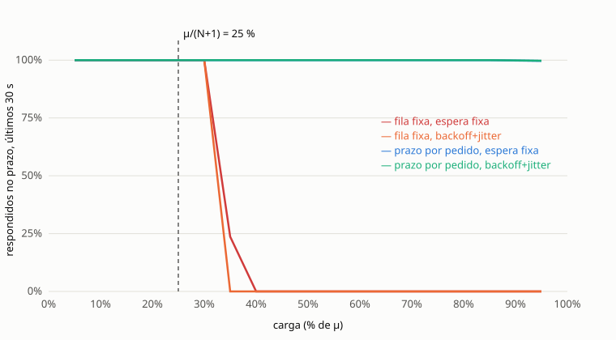

# Análise matemática e simulação

Validação independente da bancada: contas fechadas + um simulador de eventos discretos
(`simulador.py`, só biblioteca padrão do Python, roda em ~3 s, sem Docker). Ele implementa as
mesmas 4 políticas de fila e os 2 clientes com os parâmetros calibrados (C = 8, Q = 64,
Ŝ = 42 ms, falha +200 ms por 20 s, timeouts 100/200 ms, N = 3, W = 98 ms).

```sh
python3 modelo/simulador.py analitico            # contas fechadas
python3 modelo/simulador.py grade --reps 3       # mesmo desenho 4 × 2 × 4 da bancada
python3 modelo/simulador.py fronteira --reps 3 --svg modelo/fronteira.svg
python3 modelo/simulador.py transicao --reps 10  # fila fixa entre 26 e 40 %
```

As saídas desta versão estão em `saida_*.txt` e `fronteira.svg`.

## 1. Contas fechadas

| Grandeza | Conta | Valor | Bancada |
|---|---|---:|---:|
| Capacidade μ | C / Ŝ = 8 / 42 ms | 190,5 req/s | 190,45 |
| Capacidade na falha | C / (Ŝ + 200 ms) | 33,1 req/s | ~33 |
| Espera com fila cheia | Q / μ = 64 / 190 | 336 ms | — |
| Amplificação no estado preso | N + 1 | 4 | 4,00–4,04 |
| Limite necessário do laço | λ* = μ / (N + 1) | 25 % de μ | — |
| W (limite fixo) | 150 − 42 − 10 | 98 ms | 98 |
| Espera útil, impaciente | 100 − 42 − 10 | 48 ms | — |
| Espera útil, paciente | 200 − 42 − 10 | 148 ms | — |

**Por que o laço fecha.** Com a fila cheia, um pedido espera Q/μ ≈ 336 ms, mais do que os
dois timeouts. Então, na fila FIFO sem descarte, todo pedido atendido já foi abandonado: o
goodput é zero e cada pedido novo vira N + 1 = 4 tentativas. O estado preso só se sustenta
se essas tentativas mantêm o servidor saturado: (N + 1)·λ ≥ μ, ou seja, λ ≥ 25 % de μ.

**Por que o limite fixo falha só para o impaciente.** W = 98 ms > 48 ms de espera útil do
impaciente: o servidor começa pedidos que vão terminar depois do timeout (trabalho
desperdiçado, ~135 req/s medidos a 70 %). Para o paciente, W < 148 ms: ele é descartado cedo
demais, mas os que passam são úteis.

**Por que prazo por pedido e LIFO funcionam.** Descartar na saída da fila custa ~0, então um
worker livre limpa de uma vez todo o prefixo vencido e só gasta os 42 ms com pedido que ainda
termina no prazo. O trabalho útil fica perto de μ, e o laço fica sem combustível.

## 2. Simulação × bancada

A grade simulada (`saida_grade.txt`) reproduz o desfecho das 32 células da repetição 1 da
bancada, inclusive os casos não óbvios:

- fila fixa: recupera a 20 %, presa a 50 e 70 %, **cai antes da falha a 90 %**;
- limite fixo: recupera a 20 e 50 %, presa a 70 %, cai antes da falha a 90 %;
- prazo por pedido e LIFO: recuperam em todas as cargas;
- espera fixa × backoff não muda nenhum desfecho.

Diferença: na bancada, o limite fixo com espera fixa já cai *antes* da falha a 70 %. No
simulador, só depois. Uma explicação plausível são as engasgadas do ambiente (até 47 ms),
que a simulação não tem e que funcionam como gatilho extra.

## 3. Achado: 25 % é condição necessária, não suficiente



Varrendo a carga da fila fixa de 2 em 2 % com 10 sementes (`saida_transicao.txt`):

| Carga | 26–28 % | 30 % | 32–34 % | ≥ 36 % |
|---|---|---|---|---|
| Execuções presas (espera fixa / backoff) | 0 / 0 | 0 / 2 | 7–8 de 10 | 10 / 10 |

A conta (N+1)·λ ≥ μ supõe que *toda* tentativa estoura o timeout. Logo acima de 25 %, a fila
oscila. Quando ela cai abaixo de ~38 posições (38/μ ≈ 200 ms), pedidos pacientes voltam a ser
atendidos no prazo, a amplificação cai abaixo de 4 e o sistema escapa. Por isso a transição é
**probabilística** e fica entre 30 e 36 %, não um degrau em 25 %. Isso bate com a definição de
metaestabilidade (Bronson et al., HotOS '21): a mesma carga pode ou não prender, dependendo do
caminho.

**Proposta para a bancada:** rodar a fila fixa a 25, 30, 35 e 40 % (2 clientes × 3
repetições = 24 execuções, ~1 h) para medir a transição real e comparar com a simulação.

## 4. Limitações do modelo

- Sem rede e sem engasgadas do ambiente; o ruído do tempo de serviço é só normal, com dp de 1,5 ms.
- A falha é aplicada a quem *começa* o serviço durante a janela, não a cada resposta do banco.
- O simulador foi escrito a partir da descrição das políticas (methodology.md), não do código Go.
  Concordar com a bancada é evidência de que as duas implementações estão certas, mas não é prova.
