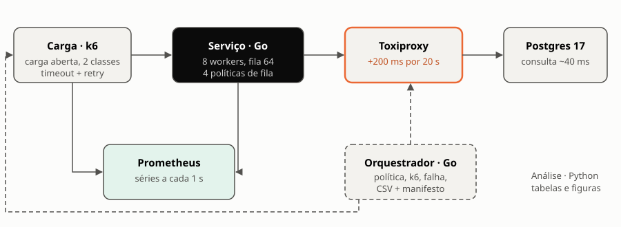
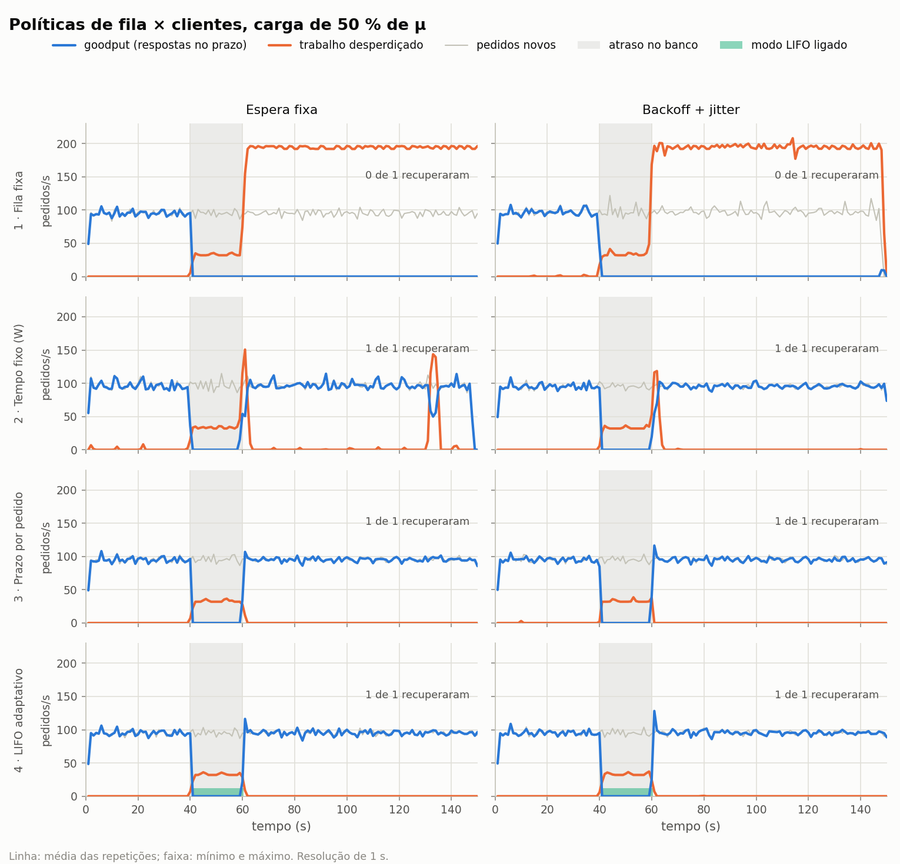
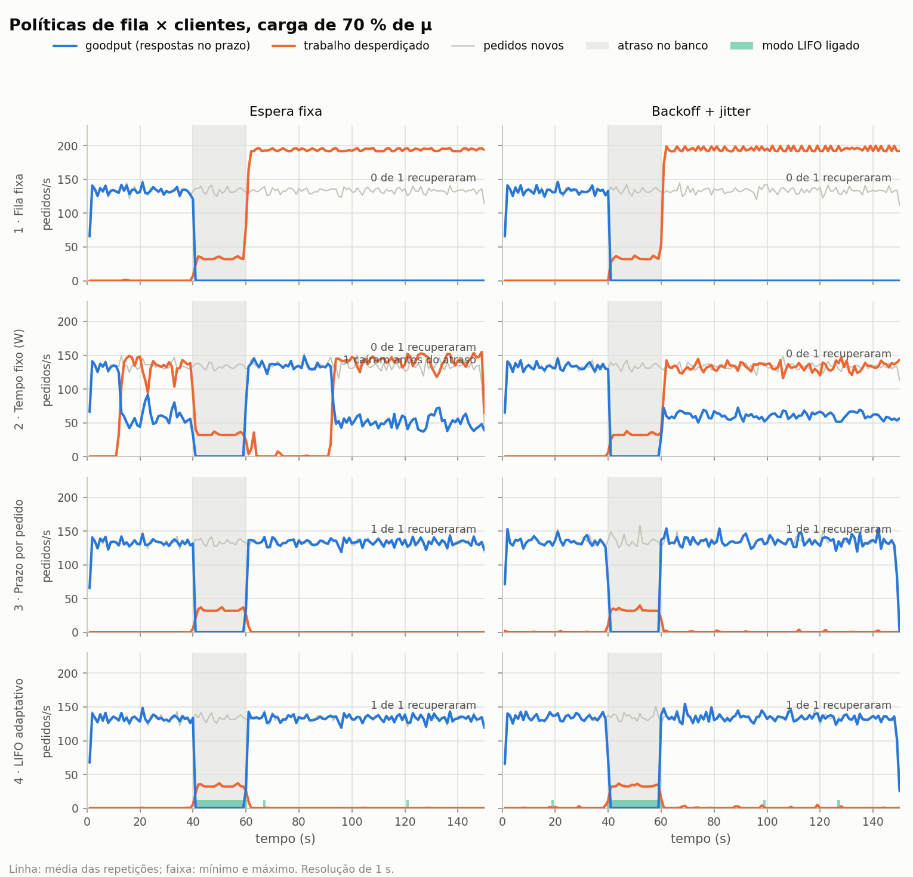
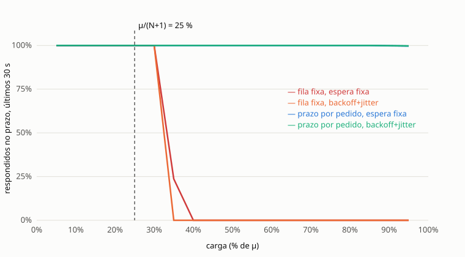

> **Rascunho.** Trechos marcados com **[PREENCHER]** dependem de dados ou decisões da equipe
> (repetições 2 e 3, experimento 1, contribuições, uso de IA). Ver `PROXIMOS_PASSOS.md`.

# 1. Motivação

Serviços distribuídos se protegem de falhas passageiras com **timeout e retry**: num sistema
assíncrono, o cliente não distingue um servidor lento de um servidor morto, então espera um
tempo fixo e tenta de novo. Esse mecanismo, desenhado para aumentar a disponibilidade, pode
fazer o contrário. Quando uma dependência fica lenta, os pedidos esperam na fila além do
timeout, o cliente desiste e reenvia, e o servidor continua processando os pedidos abandonados.
Chegam mais tentativas do que o servidor consegue atender, a fila não esvazia, e o laço se
realimenta.

O resultado é uma **falha metaestável** (Bronson et al., 2021): o gatilho (o atraso no banco)
vai embora, mas o sistema continua fora do ar, sustentado pela carga que ele mesmo gera. O
sistema tem dois estados estáveis, um saudável e um preso, e um empurrão passageiro basta para
passar de um ao outro. Huang et al. (2022) encontraram 22 falhas desse tipo em 11 organizações,
incluindo 4 dos 15 maiores incidentes da AWS da década.

**Desafio em Sistemas Distribuídos.** O problema não está num componente isolado: ele surge da
interação entre cliente (timeout, política de retry), servidor (fila, workers) e dependência
(banco). Reproduzi-lo exige carga aberta, injeção de falha controlada, medição com resolução de
1 s e cuidado para que o próprio ambiente de medição não seja o gatilho.

# 2. Trabalhos relacionados

| Trabalho | O que faz | O que deixa aberto |
|---|---|---|
| Bronson et al., HotOS '21 | Nomeia o fenômeno, define os estados estável/vulnerável/metaestável | Não mede mitigações em bancada |
| Huang et al., OSDI '22 | 22 casos reais em 11 organizações; reprodutores com código aberto | Não compara políticas de fila sob o mesmo gatilho **[a verificar]** |
| Formal Analysis of Metastable Failures, arXiv '25 | Modelos formais; M/M/c padrão não exibe o fenômeno | Não confronta o modelo com medição **[a verificar]** |
| Aderaldo et al., SP&E '25 | Benchmark declarativo de padrões de resiliência em microsserviços | Carga aberta e medição após o gatilho **[a verificar]** |
| Schroeder et al., NSDI '06 | Carga fechada esconde sobrecarga; justifica carga aberta | Base de método, não trata o fenômeno |
| Maurer, "Fail at Scale", ACM Queue 2015 (Facebook) | Propõe **LIFO adaptativo** e CoDel para filas de servidor | Relato de engenharia, sem comparação controlada |
| Nichols e Jacobson, "Controlling Queue Delay", ACM Queue 2012 | CoDel: controla a fila pelo tempo de espera, não pelo tamanho | Pensado para redes, não para filas de aplicação |
| Brooker, AWS Builders' Library | Timeouts, retries, backoff com jitter | Mostra que jitter espalha os retries, não que evita o laço |
| Beyer et al., *Site Reliability Engineering* (Google), cap. 21–22 | Propagação de prazo (deadline) e descarte de carga | Recomendação qualitativa, sem medição |

**Gap.** As mitigações já existem na indústria (prazo propagado, LIFO adaptativo, backoff com
jitter), mas são descritas separadamente e sem uma comparação controlada, sob o mesmo gatilho
e as mesmas chegadas, de **qual delas tira o sistema do estado preso, em que carga e a que
custo**.

# 3. Objetivo

Construir uma **bancada aberta e reprodutível** e usá-la para responder:

> Qual política de fila no servidor faz o serviço voltar ao normal depois de um atraso
> passageiro no banco, em cargas em que uma fila fixa fica presa? Quanto cada uma custa quando
> nada está errado? A resposta depende de como os clientes fazem retry?

O trabalho tem dois experimentos. O **experimento 1** mediu a fronteira de recuperação em
função da carga e da política de retry. Ele mostrou que o laço fecha e que backoff com jitter
não resolve. O **experimento 2**, foco deste relatório, compara 4 políticas de fila sob 2
políticas de retry. A mudança de foco está registrada em `docs/decisoes/0002-pivo-politicas-de-fila.md`.

# 4. Proposta

## 4.1 Requisitos

**Funcionais**

- Gerar carga aberta (taxa independente das respostas) com timeout e retry no cliente, em
  duas classes de timeout.
- Implementar no serviço 4 políticas de fila trocáveis em execução, sem reiniciar.
- Injetar atraso no banco numa janela programada, sem alterar o código do serviço.
- Medir, por segundo e por classe: fração respondida no prazo, trabalho desperdiçado,
  amplificação, descartes por motivo e tempo de recuperação.
- Rodar a campanha inteira com um comando e exportar CSV e manifesto de cada execução.

**Não funcionais**

- μ e Ŝ reprodutíveis (3 janelas dentro de ±5 %) e consistentes pela lei de Little (±3 %).
- Roda num laptop com Docker Compose; nada instalado no host além do Docker.
- Comparação justa: mesmas chegadas para todas as configurações, ordem embaralhada,
  execuções contaminadas pelo ambiente descartadas automaticamente.

## 4.2 Arquitetura



| Componente | Papel |
|---|---|
| Serviço (Go) | 8 workers, fila de 64 posições, consulta ao Postgres (~40 ms). Não cancela trabalho em andamento. |
| Carga (k6) | Chegadas abertas; classe impaciente (timeout 100 ms) e paciente (200 ms), 50 % cada; até N = 3 retries. |
| Toxiproxy | Entre serviço e banco: +200 ms em cada resposta por 20 s. |
| Postgres 17 | Banco real. |
| Prometheus | Coleta a cada 1 s do serviço e do k6. |
| Orquestrador (Go) | Calibra, troca a política, roda o k6, liga e desliga a falha, grava CSV e manifesto. |
| Análise (Python) | Tabelas e figuras a partir dos CSV. |

## 4.3 Políticas de fila

Todas usam a mesma fila física (Q = 64) e os mesmos 8 workers. O descarte responde 503 na hora.

1. **Fila fixa (referência):** FIFO; rejeita quem chega com a fila cheia.
2. **Limite de tempo fixo:** na saída, descarta quem esperou mais que W = 98 ms
   (timeout médio − Ŝ − margem).
3. **Prazo por pedido:** o cliente envia o próprio timeout (`X-Budget-Ms`). Na saída, o servidor
   descarta quem não termina antes do próprio prazo: agora + Ŝ + margem > prazo.
4. **LIFO adaptativo** (Maurer, 2015): FIFO normalmente. Se a fila não esvazia há mais de
   100 ms, passa a atender o mais novo, despejar o mais antigo quando cheia e limpar os
   vencidos.

Políticas de retry no cliente: **espera fixa** de 50 ms, ou **backoff exponencial com jitter**,
uniforme em [0, min(1 s, 100 ms·2^(k−1))].

## 4.4 Desenho experimental

Fatorial completo: 4 filas × 2 clientes × 4 cargas (20, 50, 70, 90 % de μ) × 3 repetições =
96 execuções. Cada execução tem 10 s de aquecimento, 30 s de regime, 20 s de falha e 90 s de
recuperação.

# 5. Protótipo

## 5.1 Implementação

| Parte | Arquivos | Linhas |
|---|---|---:|
| Serviço | `experimento/servidor/server.go`, `main.go` | ~710 |
| Carga | `experimento/cliente/script.js` | ~160 |
| Orquestrador | `experimento/orquestrador/*.go` (com testes) | ~3.400 |
| Análise | `experimento/analise/analise.py`, `estatistica.py` | ~420 |
| Modelo e simulação | `experimento/modelo-matematico/simulador.py` | ~300 |

## 5.2 Testes realizados

- **Unitários:** 17 testes no serviço (políticas, descarte, detector de sobrecarga) e 23 no
  orquestrador (métricas, classificação de desfecho), mais `go vet`. Eles rodam dentro do build
  das imagens, então a imagem só é criada se passarem.
- **Calibração:** μ = 190,45 req/s e Ŝ = 42,03 ms. As 3 janelas concordam em 0,11 % e 0,07 %,
  e a lei de Little explica μ com erro de 0,14 %.
- **Guardas de medição:** congelamento do ambiente acima de 50 ms ou amostras faltando no
  Prometheus descartam a execução e a repetem. Na repetição 1, uma execução foi descartada
  (congelamento de 76 ms). Nenhuma iteração do k6 foi descartada (carga continuou aberta) e não
  houve erros de cliente nem de banco.
- **Validação independente por simulação:** um simulador de eventos discretos, escrito a partir
  da especificação das políticas, reproduz o desfecho das 32 células (seção 5.4).

## 5.3 Resultados (repetição 1; repetições 2 e 3: **[PREENCHER]**)

| Política de fila | Cliente | 20 % | 50 % | 70 % | 90 % |
|---|---|---|---|---|---|
| 1 · Fila fixa | espera fixa | recuperou | **presa** (0 %) | **presa** (0 %) | caiu antes da falha |
| | backoff | recuperou | **presa** (0,7 %) | **presa** (0 %) | caiu antes da falha |
| 2 · Limite fixo | espera fixa | recuperou | recuperou (94,7 %) | caiu antes da falha | caiu antes da falha |
| | backoff | recuperou | recuperou | **presa** (45 %) | caiu antes da falha |
| 3 · Prazo por pedido | ambos | 0 s | 0 s | 0 s | 0–1 s |
| 4 · LIFO adaptativo | ambos | 0 s | 0 s | 0 s | 0 s |

Os percentuais entre parênteses são a fração respondida no prazo nos últimos 30 s.





- **Fila fixa:** no estado preso, a amplificação é 4,00 = N + 1. Os 8 workers gastam ~190 req/s
  com pedidos já abandonados.
- **Limite fixo:** W = 98 ms é maior que os 48 ms de espera útil do impaciente. O impaciente
  termina com 0–3 % respondidos e ~135 req/s de trabalho desperdiçado, enquanto o paciente
  continua sendo atendido. O laço reaparece, confinado a uma classe.
- **Prazo por pedido:** recuperou nas 8 execuções, sem trabalho desperdiçado e sem nenhum
  descarte desnecessário. Custo em regime: ≤ 3 descartes/s.
- **LIFO adaptativo:** recuperou nas 8. O detector ficou ligado em 90–100 % de cada falha, mas
  a 90 % também dispara em rajadas normais. Com backoff, descartou 12,4 req/s em regime, dos
  quais 6,3 req/s de pacientes que ainda seriam atendidos.
- **Espera fixa × backoff:** não mudou nenhum desfecho de recuperação.

## 5.4 Análise matemática

Detalhes e código em `experimento/modelo-matematico/`.

- **Capacidade:** μ = C/Ŝ = 190,5 req/s (medido: 190,45). Na falha, μf = C/(Ŝ + 200 ms) =
  33 req/s.
- **Condição para o laço:** com a fila cheia, a espera é Q/μ = 336 ms, maior que os dois
  timeouts. Então, na FIFO, todo pedido atendido já foi abandonado, e a amplificação no estado
  preso é N + 1 = 4 (medido: 4,00–4,04).
- **Fronteira necessária:** o estado preso só se sustenta se (N + 1)·λ ≥ μ, ou seja,
  λ ≥ μ/4 = 25 %. Isso explica a recuperação a 20 % e o estado preso a 50 %.
- **Fronteira real (simulação):** a transição é probabilística, entre 30 e 36 % (figura
  abaixo). Logo acima de 25 %, quando a fila oscila abaixo de ~38 posições, os pacientes voltam
  a ser atendidos e o sistema escapa. Conclusão: 25 % é condição **necessária**, não suficiente.
  Validar na bancada: **[PREENCHER]**.



# 6. Conclusões

**Objetivo retomado.** Descobrir qual política de fila tira o serviço do estado metaestável
criado por retries.

1. **Quem decide a recuperação é a fila do servidor, não o cliente.** Backoff com jitter
   espaça os retries, mas não reduz quantos são. Não mudou nenhum desfecho.
2. **Um limite de tempo precisa casar com o timeout de cada cliente.** Um limite único,
   dimensionado para o cliente médio, recria o laço para os clientes mais impacientes, e pode
   disparar até sem falha injetada.
3. **O prazo por pedido foi a melhor política única:** recuperou em todas as configurações,
   com o menor custo em regime e sem descarte desnecessário. A exigência prática é que o cliente
   propague o próprio prazo (como fazem os deadlines do gRPC).
4. **O LIFO adaptativo funciona sem precisar do prazo do cliente**, mas sob carga alta o
   detector dispara em rajadas normais e descarta pedidos úteis.
5. **Um modelo simples prevê a bancada.** As contas fechadas e a simulação reproduzem os
   desfechos. A fronteira μ/(N+1) é só um limite inferior; a transição real é probabilística.

**Limitações.** Uma máquina (2 vCPUs), um tipo de falha, tempo de serviço quase constante,
janela de recuperação de 90 s, parâmetros W e janela do detector não otimizados por política,
retries limitados sem retry budget.

**Trabalhos futuros (TG).**

- Medir na bancada a transição entre 25 e 40 %.
- Limite fixo ajustado para o menor timeout (W = 48 ms), para mostrar o outro lado do trade-off.
- Tempo de serviço variável (o Ŝ do prazo por pedido fica impreciso).
- Retry budget e circuit breaker.
- Mais de um serviço em cadeia (propagação de prazo).
- Modelo analítico de filas para a probabilidade de ficar preso.

# 7. Organização do grupo

| Aluno | Atividades | % |
|---|---|---:|
| João Guerreiro | **[PREENCHER]** | **[ ]** |
| Lucas de Sousa | **[PREENCHER]** | **[ ]** |
| Marcelo Hippolyto | **[PREENCHER]** | **[ ]** |
| Pablo Carvalho | **[PREENCHER]** — sugestão: análise matemática e simulação (`experimento/modelo-matematico/`) | **[ ]** |

# 8. Uso de IA

**[PREENCHER com honestidade — o enunciado exige.]** Declarar, por pessoa, onde a IA foi usada
(ex.: dúvidas de Go/k6, revisão de texto, geração de rascunho de documentos e código) e o que a
equipe fez: concepção do experimento, decisões de desenho, execução, verificação dos
resultados. Cada membro deve conseguir explicar a própria parte do código.

# Como instalar e executar

Requisito: Docker com Compose.

```sh
cd experimento
./bancada.sh testes                     # build + testes unitários
./bancada.sh calibrar                   # mede μ e Ŝ
./experimentos.sh                       # campanha completa: 96 execuções, ~4 h 30
./bancada.sh cenario -fila lifo -politica fixed -carga 70   # uma execução
./bancada.sh analise --varredura principal                  # tabelas e figuras
python3 analise/estatistica.py resultados/principal/resumo.csv   # média ± dp das repetições
python3 modelo-matematico/simulador.py grade       # simulação, sem Docker
```

# Referências

- N. Bronson, A. Aghayev, A. Charapko, T. Zhu. *Metastable Failures in Distributed Systems.* HotOS 2021.
- L. Huang et al. *Metastable Failures in the Wild.* OSDI 2022.
- B. Schroeder, A. Wierman, M. Harchol-Balter. *Open Versus Closed: A Cautionary Tale.* NSDI 2006.
- B. Maurer. *Fail at Scale.* ACM Queue 13(8), 2015.
- K. Nichols, V. Jacobson. *Controlling Queue Delay.* ACM Queue 10(5), 2012.
- M. Brooker. *Timeouts, retries, and backoff with jitter.* Amazon Builders' Library.
- B. Beyer et al. *Site Reliability Engineering*, caps. 21–22. O'Reilly, 2016.
- *Formal Analysis of Metastable Failures*, arXiv 2025 **[completar autores]**.
- Aderaldo et al., Software: Practice and Experience 2025 **[completar título]**.
